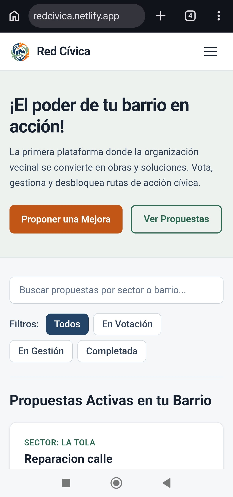
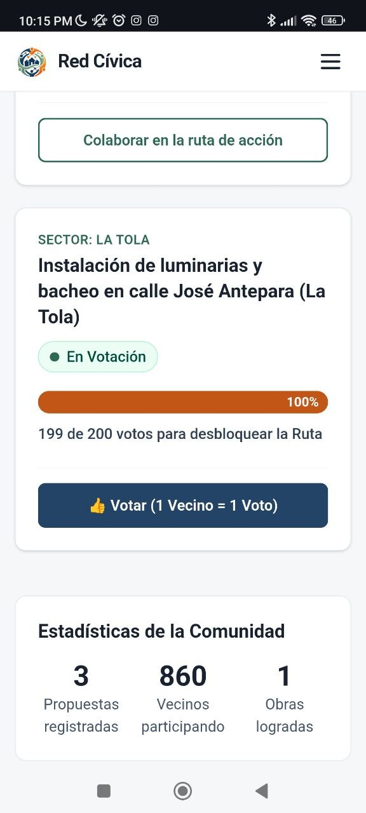
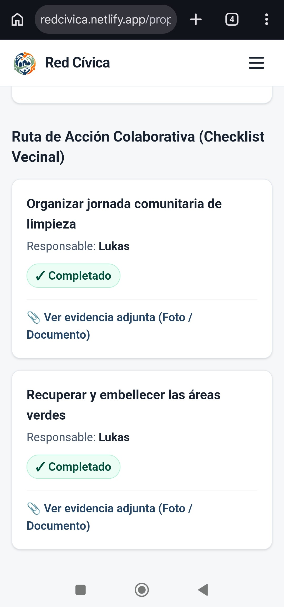
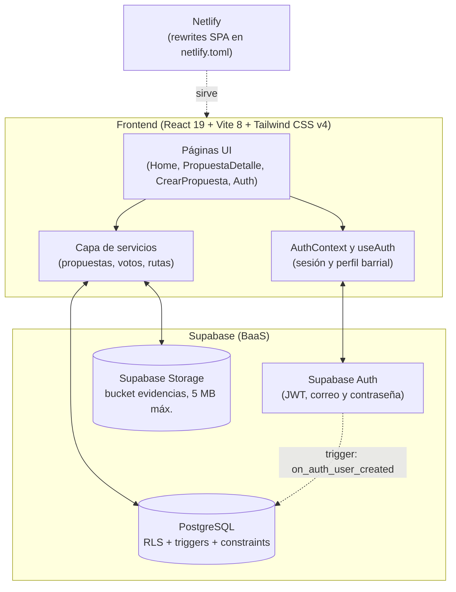
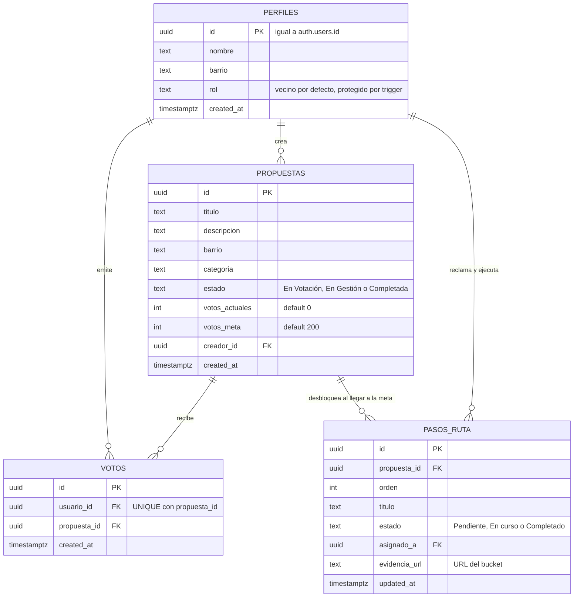

<div align="center">
  
  <h1>🏙️ Red Cívica</h1>
  <p><strong>Donde la organización vecinal se convierte en obras y soluciones.</strong></p>
  <p>Plataforma web <em>mobile-first</em> de participación ciudadana y tecnología cívica (CivicTech) desarrollada para los barrios de Quito, Ecuador, alineada con el <strong>ODS 10 (Meta 10.2: Inclusión social, económica y política)</strong>.</p>

  <p>
    <a href="https://redcivica.netlify.app"></a>
    
    
    
    
  </p>
</div>

> **🏆 EagleDev 2026 · Categoría Contemporáneo · Nivel Universidades**  
> **Equipo:** Team Error404 (Lukas Bustamante, Mateo Hidalgo, Sheldon López) · **IES:** Universidad de Las Américas (UDLA) · **Tutor:** Santiago Solórzano  
> **Documentación:** [Declaración de uso de IA](docs/declaracionIA.md) · [Pruebas de seguridad](docs/pruebasSeguridad.md) · [Arquitectura](#stack-y-arquitectura) · [Base de datos](#base-de-datos-y-almacenamiento)

---

## 📋 Contenido

- [📋 Contenido](#-contenido)
- [🎯 Problema y ODS](#-problema-y-ods)
- [✨ Características Principales](#-características-principales)
- [🔄 Flujo de Usuario ("De la queja a la obra")](#-flujo-de-usuario-de-la-queja-a-la-obra)
- [📱 Capturas y Demo en Movimiento](#-capturas-y-demo-en-movimiento)
  - [Flujo de Activación Automática ("La Compuerta" a los 200 votos)](#flujo-de-activación-automática-la-compuerta-a-los-200-votos)
  - [Vistas Principales (Mobile-First)](#vistas-principales-mobile-first)
- [💼 Modelo de Negocio e Impacto Territorial](#-modelo-de-negocio-e-impacto-territorial)
- [🛠️ Stack y Arquitectura](#️-stack-y-arquitectura)
- [📁 Estructura del Proyecto](#-estructura-del-proyecto)
- [🗄️ Base de Datos y Almacenamiento](#️-base-de-datos-y-almacenamiento)
- [🔐 Seguridad por Diseño (Zero-Trust)](#-seguridad-por-diseño-zero-trust)
- [🧪 Auditoría y Pruebas](#-auditoría-y-pruebas)
- [🚀 Instalación y Configuración](#-instalación-y-configuración)
  - [1. Clonar e instalar dependencias](#1-clonar-e-instalar-dependencias)
  - [2. Variables de Entorno](#2-variables-de-entorno)
  - [3. Configuración de Base de Datos (Supabase)](#3-configuración-de-base-de-datos-supabase)
  - [4. Acceso Rápido a la Demo (Evaluación)](#4-acceso-rápido-a-la-demo-evaluación)
- [🤖 Uso de IA Generativa](#-uso-de-ia-generativa)
- [📈 Roadmap y Trabajo Futuro](#-roadmap-y-trabajo-futuro)
- [📄 Licencia](#-licencia)

---

<a id="problema-y-ods"></a>
## 🎯 Problema y ODS

Los barrios de Quito saben exactamente qué necesitan (luminarias, bacheo, seguridad, mantenimiento de espacios públicos), pero muchas veces sus reclamos mueren en chats de WhatsApp o son rechazados en ventanillas municipales por errores de forma y falta de guía técnica. Pagan el costo las comunidades con menos recursos y menor acceso a asesoría.

**Red Cívica** conecta dos mundos hoy separados: la **organización vecinal** y la **gestión municipal**. El proyecto se alinea directamente con el **ODS 10 (Reducción de las desigualdades), Meta 10.2**: promover la inclusión social, económica y política de todas las personas.

---

<a id="características-principales"></a>
## ✨ Características Principales

- **Democracia Barrial (`1 Vecino = 1 Voto`):** El voto único está garantizado a nivel de motor de base de datos mediante una restricción `UNIQUE (usuario_id, propuesta_id)` y bloqueo de votos fuera de fase.
- **La Compuerta (Triggers Automáticos):** Transiciones de estado (`En Votación` → `En Gestión` → `Completada`) gobernadas íntegramente por triggers en PostgreSQL al alcanzar la meta de 200 votos.
- **Ruta de Acción Colaborativa:** Al desbloquearse la gestión, se genera una guía de 3 pasos redactados en lenguaje sencillo de barrio. Los vecinos reclaman pasos de forma atómica (evitando colisiones de concurrencia) y suben evidencia verificable (fotos o PDFs de hasta 5 MB).
- **Progreso Calculado en Tiempo Real:** El porcentaje de avance se computa dinámicamente a partir de los pasos completados, evitando inconsistencias de estado.
- **Perfil Barrial Automatizado:** Cada vecino se registra asociado a su sector; el perfil se crea automáticamente mediante un trigger (`SECURITY DEFINER`) al registrarse.
- **Exploración y Diseño Mobile-First:** Filtros por estado, búsqueda por barrio o palabra clave, tipografía legible y alto contraste pensado para uso desde el celular en territorio.

---

<a id="flujo-de-usuario-de-la-queja-a-la-obra"></a>
## 🔄 Flujo de Usuario ("De la queja a la obra")

1. **Registro Barrial:** El vecino crea su cuenta vinculada a su sector de Quito.
2. **Propuesta:** Publica una mejora para su barrio (nace en estado `En Votación`).
3. **Votación:** Los vecinos respaldan la iniciativa (`1 vecino = 1 voto`). Al llegar a **200 votos**, un trigger cambia el estado a `En Gestión` y desbloquea la **Ruta de Acción**.
4. **Ejecución Colaborativa:** Los vecinos reclaman pasos disponibles, realizan la gestión correspondiente y adjuntan evidencia verificable.
5. **Obra Completada:** Cuando todos los pasos cuentan con evidencia válida y están marcados como completados, la propuesta pasa automáticamente a `Completada`.

---

<a id="capturas-y-demo-en-movimiento"></a>
## 📱 Capturas y Demo en Movimiento

### Flujo de Activación Automática ("La Compuerta" a los 200 votos)

<div align="center">
  
  <p><em>Transición automática de <code>En Votación</code> a <code>En Gestión</code> mediante trigger en PostgreSQL y reclamo de paso colaborativo.</em></p>
</div>

### Vistas Principales (Mobile-First)

| Exploración y Filtros | Votación (1 Vecino = 1 Voto) | Ruta de Acción y Evidencia |
| :---: | :---: | :---: |
|  |  |  |

---

<a id="modelo-de-negocio-e-impacto-territorial"></a>
## 💼 Modelo de Negocio e Impacto Territorial

Red Cívica opera bajo un modelo híbrido **Freemium + B2B** diseñado para garantizar acceso universal al ciudadano y sostenibilidad financiera a mediano plazo:

| Segmento | Plan | Propuesta de Valor |
| :--- | :--- | :--- |
| **Ciudadanos** | **Gratuito ($0)** | Proponer mejoras, votar y colaborar en rutas de acción sin barreras económicas. |
| **Dirigentes y Comités** | **Premium ($5,99/mes o $59,90/año)** | Guías legales detalladas y plantillas de oficios listas para ingresar (ahorro frente a asesorías externas de $15–$40). |
| **Municipios y ONG** | **Licencias B2B** | Analítica territorial y trazabilidad de necesidades priorizadas por sector. |

- **Validación Financiera (Proyección a 12 meses):** Costo operativo fijo estimado de ~$272,50 a $322,50/mes, punto de equilibrio en **59 comités suscritos** y flujo de caja positivo a partir del **mes 9**.
- **Piloto Territorial:** Inversión semilla proyectada de $3.700 USD para un piloto inicial de 12 meses en **3 barrios de Quito (La Tola, Mariscal y La Floresta)**, escalable a 12 sectores.

---

<a id="stack-y-arquitectura"></a>
## 🛠️ Stack y Arquitectura

| Capa | Tecnología |
| :--- | :--- |
| **Frontend** | [React 19](https://react.dev/) + [Vite 8](https://vite.dev/) |
| **Estilos** | [Tailwind CSS v4](https://tailwindcss.com/) (Mobile-First) |
| **Enrutamiento** | [React Router DOM v7](https://reactrouter.com/) (Code-splitting con `React.lazy`) |
| **Backend (BaaS)** | [Supabase](https://supabase.com/) (Auth, PostgreSQL con RLS y Triggers, Storage) |
| **Despliegue** | [Netlify](https://www.netlify.com/) (Rewrites SPA en `netlify.toml`) |
| **Calidad** | ESLint 10 (React Hooks, React Compiler, Fast Refresh) y `node --test` |

Las vistas nunca consultan directamente a Supabase: toda comunicación pasa por una **capa de servicios desacoplada**. Las reglas críticas de negocio y seguridad viven en **PostgreSQL**, aplicando una arquitectura **Zero-Trust** en el cliente.



---

<a id="estructura-del-proyecto"></a>
## 📁 Estructura del Proyecto

```text
├── docs/                    # Declaración de IA y reporte de pruebas de seguridad
├── supabase/
│   └── migrations/          # Scripts SQL (ejecutar en el orden indicado en Instalación)
│       ├── tablas.sql           # Tablas, restricciones e índices
│       ├── rlsIniciales.sql     # Triggers de estados + RLS (versión inicial, pre-auditoría)
│       ├── seguridad.sql        # Endurecimiento tras la auditoría (reemplaza políticas vulnerables)
│       ├── datosDemo.sql        # Datos de ejemplo para la demo
│       └── reinicioDemo.sql     # Restablece la demo a su estado inicial
├── public/                  # logo.jpeg
├── assets/                  # Capturas de pantalla y GIFs para documentación
├── src/
│   ├── components/          # ChecklistRuta, EstadoBadge, HeroBanner, Navbar,
│   │                        # ProgressBar, PropuestaCard, ProtectedRoute
│   ├── constants/           # barrios.js, propuestas.js (estados, categorías, filtros)
│   ├── context/             # AuthContext.jsx (sesión y perfil barrial)
│   ├── db/                  # supabase.js (cliente de Supabase)
│   ├── hooks/               # useAuth.js
│   ├── pages/               # Auth, CrearPropuesta, Home, PropuestaDetalle
│   ├── services/            # propuestasService, rutasService, votosService
│   ├── utils/               # progreso.js (cálculo del porcentaje)
│   ├── App.jsx              # Rutas con carga diferida (React.lazy)
│   ├── main.jsx
│   ├── App.css
│   └── index.css
├── test/                    # Pruebas unitarias (node --test)
├── .env.example             # Plantilla de variables de entorno
├── netlify.toml             # Redirecciones SPA para React Router
├── eslint.config.js
├── package.json
└── vite.config.js
```

---

<a id="base-de-datos-y-almacenamiento"></a>
## 🗄️ Base de Datos y Almacenamiento



- `votos_actuales`, el estado de la propuesta y los pasos de la ruta los actualizan exclusivamente **triggers en PostgreSQL**, nunca el cliente.
- **Storage:** Bucket `evidencias` de lectura pública, restringido a nivel de servidor a archivos **JPG, PNG, WEBP y PDF de hasta 5 MB**.

---

<a id="seguridad-por-diseño-zero-trust"></a>
## 🔐 Seguridad por Diseño (Zero-Trust)

La seguridad y la integridad de los datos se aplican en el servidor mediante **Row Level Security (RLS)** y triggers de PostgreSQL, cumpliendo con los principios de minimización de datos de la **LOPDP de Ecuador**:

- **Anti-escalada de privilegios:** El perfil se genera mediante un trigger al registrarse con `rol = 'vecino'` y el campo `rol` es inmutable desde el cliente.
- **Integridad de propuestas:** Al crear una propuesta, el servidor impone el estado inicial, contador de votos, meta y `creador_id`.
- **Aislamiento y validez de votos:** Los votos son privados (cada usuario consulta únicamente los suyos) y solo se admiten en propuestas con estado `En Votación`.
- **Reclamo atómico y evidencia verificable:** Un paso solo puede ser completado por su vecino asignado y requiere una URL de evidencia válida alojada en el bucket oficial.
- **Cero secretos expuestos:** El frontend opera únicamente con la llave pública (`publishable/anon`) de Supabase.

---

<a id="auditoría-y-pruebas"></a>
## 🧪 Auditoría y Pruebas

- **11/11 pruebas funcionales y de seguridad** superadas en entorno real con múltiples cuentas: intentos de escalada de privilegios, manipulación de propuestas, voto duplicado, aislamiento de votos, modificación de pasos ajenos, inyección de evidencia inválida, validación de archivos, transiciones automáticas y registro de usuarios. Detalle completo en [`docs/pruebasSeguridad.md`](docs/pruebasSeguridad.md).
- **5 pruebas unitarias** sobre el motor de cálculo de progreso ejecutadas con `npm test`.
- **Análisis estático limpio** sin errores ni advertencias: `npm run lint`.

---

<a id="instalación-y-configuración"></a>
## 🚀 Instalación y Configuración

### 1. Clonar e instalar dependencias

```bash
git clone [https://github.com/gab0o06/RedCivica.git](https://github.com/gab0o06/RedCivica.git)
cd RedCivica
npm install            # o pnpm install
cp .env.example .env   # completa tus credenciales de Supabase
npm run dev            # abre http://localhost:5173
```

Otros comandos disponibles: `npm run build`, `npm run lint`, `npm test`.

### 2. Variables de Entorno

| Variable | Descripción |
| :--- | :--- |
| `VITE_SUPABASE_URL` | URL de la API del proyecto en Supabase (ej. `https://xxxx.supabase.co`) |
| `VITE_SUPABASE_PUBLISHABLE_KEY` | Llave pública (`anon` / `publishable`) de Supabase |

### 3. Configuración de Base de Datos (Supabase)

Ejecuta en el **SQL Editor** de Supabase los scripts ubicados en `supabase/migrations/` **estrictamente en este orden**:

1. `tablas.sql`
2. `rlsIniciales.sql`
3. `seguridad.sql`
4. `datosDemo.sql` *(opcional, carga propuestas de ejemplo)*

> ⚠️ **Importante:** No vuelvas a ejecutar `rlsIniciales.sql` sobre una base de datos ya endurecida con `seguridad.sql`, ya que restauraría las políticas previas a la auditoría. Para restablecer la demo en cualquier momento, utiliza `reinicioDemo.sql`.

Adicionalmente:
- Crea un bucket público en **Storage** llamado `evidencias` (o verifica que las políticas de `storage.objects` de `seguridad.sql` estén activas).
- En **Authentication → Providers → Email**, desactiva *"Confirm email"* para pruebas rápidas de demo y configura la `Site URL` de tu entorno.

### 4. Acceso Rápido a la Demo (Evaluación)

> Puedes probar el flujo completo directamente en [redcivica.netlify.app](https://redcivica.netlify.app) registrando cualquier correo de prueba (no requiere verificación por email) o usando las cuentas precargadas en `datosDemo.sql`:
> - **Usuario Demo:** `[correo-demo@ejemplo.com]` · **Contraseña:** `[password-demo]` *(ajusta si tienes credenciales fijas en la demo)*

---

<a id="uso-de-ia-generativa"></a>
## 🤖 Uso de IA Generativa

Se utilizaron herramientas de IA generativa como apoyo durante el desarrollo; el equipo revisó, ejecutó y auditó cada componente. La declaración transparente (herramientas empleadas, módulos con apoyo y autoría propia) se encuentra documentada en [`docs/declaracionIA.md`](docs/declaracionIA.md), conforme al Art. 12 del reglamento de EagleDev 2026.

---

<a id="roadmap-y-trabajo-futuro"></a>
## 📈 Roadmap y Trabajo Futuro

Basado en las lecciones aprendidas y la auditoría técnica de la versión de concurso, la evolución hacia producción contempla:

1. **Voto por Sector mediante RLS (sin recolectar datos extra):** Política de seguridad que valide que `perfiles.barrio` coincida con el `barrio` de la propuesta antes de admitir un voto.
2. **Endurecimiento de Privacidad y Minimización (LOPDP):**
   - Exposición de *alias* o nombre abreviado (ej. *"María P."*) mediante una vista pública restringida en lugar del nombre completo.
   - Restricción de lectura pública en la tabla `perfiles` (cada usuario accede solo a su registro completo).
   - Migración de `evidencias` a un **bucket privado** servido mediante URLs firmadas de corta duración, acompañado de guías de anonimización en la UI.
   - Aviso de privacidad y consentimiento explícito en el flujo de registro.
3. **Verificación Comunitaria de Sector:** Códigos de invitación emitidos por directivas barriales verificadas; el sistema almacenará únicamente un indicador booleano de verificación sin guardar documentos de residencia.
4. **Seguridad en Autenticación:** Activación de confirmación de correo en producción y políticas de *rate limiting* en el registro.
5. **Biblioteca de Guías Dinámicas y Dashboard B2B:** Plantillas personalizadas según la categoría del trámite (obras públicas, seguridad, ambiente) y panel analítico para municipios y ONG.

---

<a id="licencia"></a>
## 📄 Licencia

Desarrollado por **Team Error404** (Lukas Bustamante, Mateo Hidalgo, Sheldon López) para **EagleDev 2026 — Universidad de Las Américas (UDLA)**. Distribuido bajo licencia MIT.