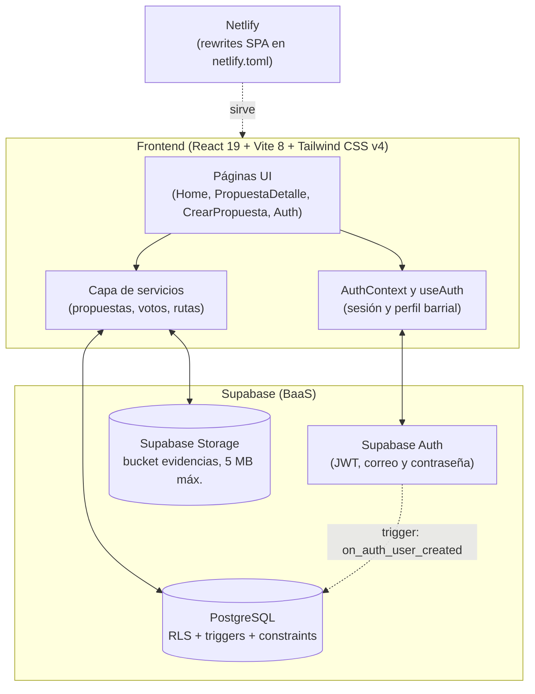
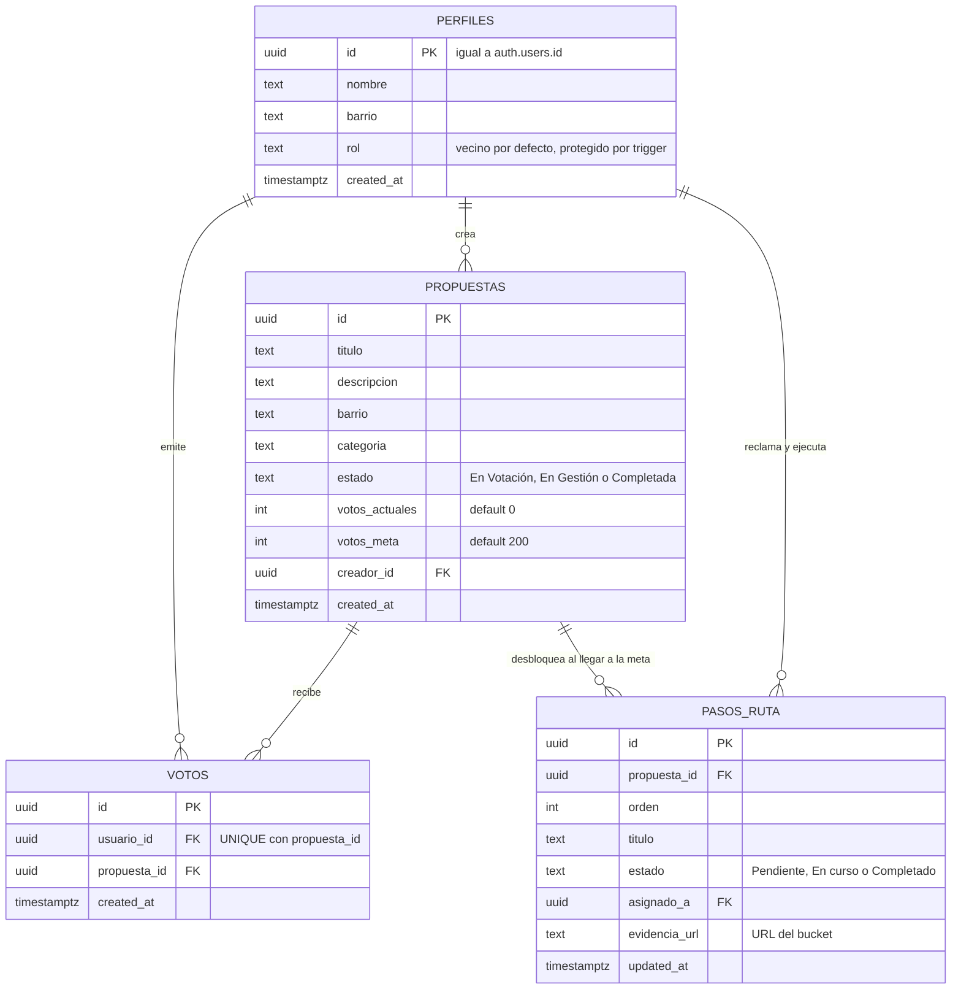

# Red Cívica 🏙️

> **Donde la organización vecinal se convierte en obras y soluciones.**
> Plataforma web para barrios de Quito: los vecinos proponen mejoras, votan (1 vecino = 1 voto) y, al llegar a la meta, se desbloquea una **Ruta de Acción** colaborativa con pasos, responsables y evidencia verificable.

**Demo en línea:** https://redcivica.netlify.app

**EagleDev 2026 · Categoría Contemporáneo · Nivel Universidades · ODS 10 (meta 10.2)**
**Equipo:** Team Error404 (Lukas Bustamante, Mateo Hidalgo, Sheldon López) · **IES:** Universidad de Las Américas (UDLA) · **Tutor:** Santiago Solórzano
**Documentación:** [Declaración de uso de IA](docs/declaracionIA.md) · [Pruebas de seguridad](docs/pruebasSeguridad.md) · [Arquitectura](#️-stack-y-arquitectura) y [Datos](#️-base-de-datos-y-almacenamiento)

---

## 📋 Contenido

- [Red Cívica 🏙️](#red-cívica-️)
  - [📋 Contenido](#-contenido)
  - [🎯 Problema y ODS](#-problema-y-ods)
  - [✨ Qué hace la plataforma](#-qué-hace-la-plataforma)
  - [🔄 Flujo de usuario](#-flujo-de-usuario)
  - [🛠️ Stack y arquitectura](#️-stack-y-arquitectura)
  - [📁 Estructura del proyecto](#-estructura-del-proyecto)
  - [🗄️ Base de datos y almacenamiento](#️-base-de-datos-y-almacenamiento)
  - [🔐 Seguridad](#-seguridad)
  - [🧪 Pruebas](#-pruebas)
  - [🚀 Instalación y configuración](#-instalación-y-configuración)
  - [🤖 Uso de IA generativa](#-uso-de-ia-generativa)
  - [🧭 Limitaciones y trabajo futuro](#-limitaciones-y-trabajo-futuro)

---

## 🎯 Problema y ODS

Los barrios saben qué necesitan, pero muchas veces no saben cómo conseguirlo: los trámites se rechazan por errores de forma y los presupuestos participativos no se ejecutan. Pagan el costo las comunidades con menos recursos y menos acceso a información.

Red Cívica conecta dos cosas que hoy están separadas: la **organización vecinal** y la **burocracia**. Se alinea con el **ODS 10 (Reducción de las desigualdades), meta 10.2**: promover la inclusión social y política de todas las personas.

## ✨ Qué hace la plataforma

- **1 vecino = 1 voto.** El voto único está garantizado en la base de datos con una restricción `UNIQUE`.
- **Estados automáticos.** `En Votación` → `En Gestión` → `Completada`, controlados por triggers de PostgreSQL.
- **Ruta de Acción colaborativa.** Al alcanzar la meta de votos se crean los pasos del trámite. Cada vecino puede reclamar un paso, liberarlo y completarlo subiendo una foto o PDF (máx. 5 MB) como evidencia. El reclamo es atómico, para evitar que dos vecinos tomen el mismo paso.
- **Progreso calculado** a partir de los pasos completados, no guardado como un número suelto.
- **Perfil barrial.** Cada vecino se registra asociado a su sector; el perfil lo crea la base de datos al registrarse.
- **Filtros** por estado de la propuesta y búsqueda por barrio o palabra clave.
- **Diseño móvil y accesible:** tipografía legible, alto contraste y textos simples.

## 🔄 Flujo de usuario

1. El vecino se registra o inicia sesión.
2. Explora las propuestas de su barrio o crea una nueva (nace en `En Votación`).
3. Los vecinos votan. Al llegar a la meta (200 votos) la propuesta pasa a `En Gestión` y se genera su Ruta de Acción.
4. Los vecinos reclaman pasos, realizan la gestión y suben evidencia.
5. Cuando todos los pasos están completados, la propuesta pasa a `Completada`.

## 🛠️ Stack y arquitectura

| Capa | Tecnología |
|---|---|
| Frontend | React 19 + Vite 8 |
| Estilos | Tailwind CSS v4 |
| Enrutamiento | React Router DOM v7 |
| Backend (BaaS) | Supabase: Auth, PostgreSQL con RLS y triggers, Storage |
| Despliegue | Netlify |
| Calidad | ESLint 10 (React Hooks, React Compiler, Fast Refresh) y pruebas unitarias |

Las páginas no hablan directamente con Supabase: pasan por una **capa de servicios**. Las reglas críticas (voto único, cambios de estado, permisos) viven en la **base de datos**, no en el navegador.



## 📁 Estructura del proyecto

```text
├── docs/                    # Declaración de IA y pruebas de seguridad
├── supabase/
│   └── migrations/          # Scripts SQL (ver orden en "Instalación")
│       ├── tablas.sql           # Tablas, restricciones e índices
│       ├── rlsIniciales.sql     # Triggers de estados + RLS (versión inicial, pre-auditoría)
│       ├── seguridad.sql        # Endurecimiento tras la auditoría (reemplaza lo vulnerable)
│       ├── datosDemo.sql        # Datos de ejemplo para la demo
│       └── reinicioDemo.sql     # Restablece la demo a su estado inicial
├── public/                  # logo.jpeg
├── src/
│   ├── components/          # ChecklistRuta, EstadoBadge, HeroBanner, Navbar,
│   │                        # ProgressBar, PropuestaCard, ProtectedRoute
│   ├── constants/           # barrios.js, propuestas.js (estados, categorías, filtros)
│   ├── context/             # AuthContext.jsx (sesión y perfil barrial)
│   ├── db/                  # supabase.js (cliente de Supabase)
│   ├── hooks/               # useAuth.js
│   ├── pages/               # Auth, CrearPropuesta, Home, PropuestaDetalle
│   ├── services/            # propuestasService, rutasService, votosService
│   ├── utils/               # progreso.js (cálculo del porcentaje)
│   ├── App.jsx              # Rutas con carga diferida (React.lazy)
│   ├── main.jsx
│   ├── App.css
│   └── index.css
├── test/                    # Pruebas unitarias (node --test)
├── .env.example             # Plantilla de variables de entorno
├── netlify.toml             # Redirecciones SPA para React Router
├── eslint.config.js
├── package.json
└── vite.config.js
```

## 🗄️ Base de datos y almacenamiento



- `votos_actuales`, el estado de la propuesta y los pasos de la ruta los actualizan **triggers**, no el cliente.
- **Storage:** bucket `evidencias` de lectura pública, limitado en el servidor a JPG, PNG, WEBP y PDF de hasta 5 MB.

## 🔐 Seguridad

La seguridad se aplica en el servidor (Row Level Security y triggers de PostgreSQL), no solo en la interfaz:

- El **perfil** se crea con un trigger al registrarse y el **rol** no puede ser modificado por el usuario.
- Al crear una propuesta, el servidor fija el estado, los votos, la meta y el creador.
- Los **votos** son privados (cada usuario ve solo los suyos) y solo se aceptan en propuestas `En Votación`.
- Un **paso** solo puede completarlo su responsable, con una evidencia válida del bucket; las transiciones de estado están restringidas.
- El bucket de **evidencias** limita tipo y tamaño de archivo en el servidor.
- El cliente usa únicamente la llave pública de Supabase; no hay claves secretas en el repositorio.

## 🧪 Pruebas

- **11 pruebas funcionales y de seguridad** ejecutadas con varias cuentas contra el proyecto real: escalada de privilegios, manipulación de propuestas, voto duplicado, aislamiento de votos, pasos ajenos, evidencia inválida, validación de archivos, estados automáticos y registro de usuarios. Resultados en [`docs/pruebasSeguridad.md`](docs/pruebasSeguridad.md).
- **Pruebas unitarias** del cálculo de progreso: `npm test`.
- **Linter** sin errores ni advertencias: `npm run lint`.

## 🚀 Instalación y configuración

```bash
git clone https://github.com/gab0o06/RedCivica.git
cd RedCivica
npm install            # o pnpm install
cp .env.example .env   # completa tus credenciales de Supabase
npm run dev            # http://localhost:5173
```

Otros comandos: `npm run build`, `npm run lint`, `npm test`.

**Variables de entorno**

| Variable | Descripción |
|---|---|
| `VITE_SUPABASE_URL` | URL de la API del proyecto en Supabase (ej. `https://xxxx.supabase.co`) |
| `VITE_SUPABASE_PUBLISHABLE_KEY` | Llave pública (anon / publishable) de Supabase |

**Base de datos:** ejecuta en el SQL Editor de Supabase, en este orden, los scripts de `supabase/migrations/`: `tablas.sql` → `rlsIniciales.sql` → `seguridad.sql` (y, opcional, `datosDemo.sql`). Crea además el bucket público `evidencias`. `reinicioDemo.sql` restablece los datos de la demo. No vuelvas a ejecutar `rlsIniciales.sql` sobre una base ya endurecida: restauraría las políticas vulnerables. En Authentication, desactiva "Confirm email" para la demo y configura la URL del sitio.

## 🤖 Uso de IA generativa

Se utilizaron herramientas de IA generativa durante el desarrollo; el equipo revisó, ejecutó y probó el resultado. La declaración completa (herramientas, partes con apoyo y partes propias) está en [`docs/declaracionIA.md`](docs/declaracionIA.md), conforme al Art. 12 del reglamento.

## 🧭 Limitaciones y trabajo futuro

**Limitaciones conocidas (versión del concurso)**

- **Validación de sector:** el barrio del perfil es declarado por el vecino y hoy cualquier usuario registrado puede votar en cualquier barrio.
- **Verificación de cuentas:** la confirmación de correo está desactivada para la demo, por lo que es posible crear cuentas múltiples.
- **Rutas por tipo de trámite:** los pasos generados son los mismos para toda propuesta.
- **Panel de administración y moderación:** el rol `admin` existe, pero aún no hay panel ni moderación previa a la votación.
- **Visibilidad de datos:** los perfiles (nombre y barrio) y las evidencias son de lectura pública para mostrar responsables y soporte de cada paso.

**Plan de mejora (no implementado)**

1. **Voto por sector, sin pedir más datos.** Una política RLS que solo acepte el voto si `perfiles.barrio` coincide con el `barrio` de la propuesta. Usa un dato que ya existe y no recolecta información nueva.
2. **Reducir la exposición de datos personales (minimización).**
   - Mostrar un *alias* o nombre abreviado (ej. "María P.") en lugar del nombre completo, mediante una vista pública que solo expone ese campo y el barrio.
   - Cerrar la lectura pública de `perfiles` y dejar a cada usuario ver solo su perfil completo.
   - Evidencias en un bucket privado con URLs firmadas de corta duración, y recomendación en la interfaz de no subir rostros, documentos de identidad ni datos de terceros.
   - Aviso de privacidad y consentimiento explícito en el registro.
3. **Verificación del sector por terceros, sin guardar documentos.** Códigos de invitación emitidos por directivas barriales o por un administrador; el sistema solo guarda un indicador de "sector verificado", no la prueba de residencia.
4. **Confirmación de correo** activada en producción y límite de tasa para el registro.
5. **Biblioteca de guías por categoría** con versionado, y **dashboard para municipios y ONG**.